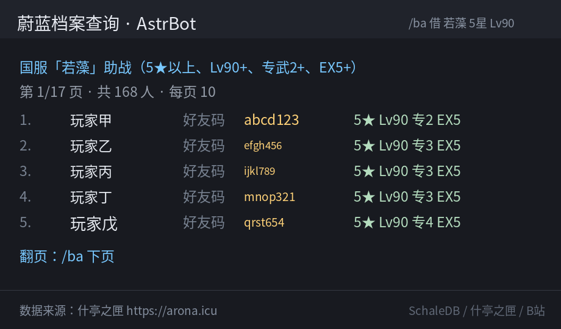

<div align="center">

# astrbot_plugin_ba_wiki

**蔚蓝档案（Blue Archive）查询插件 · 给 AstrBot 的可信数据源**

数值不靠模型编，配队不靠猜

[](https://github.com/AstrBotDevs/AstrBot)
[](https://github.com/kermond369-nsis/astrbot_plugin_ba_wiki/releases)
[](https://www.python.org/)
[](LICENSE)

技能数值 · 大决战配队 · 助战好友码 · B 站攻略



</div>

---

## 它解决什么问题

BA 群里最常问的几件事，靠模型记忆全是编的，靠联网搜索又拿不到表格：

| 群友问 | 别的 bot | 这个插件 |
|---|---|---|
| 「若藻 NS 各等级倍率」 | 甩一段模糊概括 | SchaleDB 逐级取值，1~10 级全列 |
| 「大蛇大决战蓝甲怎么配」 | 编一队出来 | 什亭之匣真实榜首三甲配队 + 上限难度 |
| 「谁挂了泳装星野能借」 | 不知道 | 逐个区服助战位 + **好友码** + 练度筛选 |
| 「有没有作业可以抄」 | 空口建议 | B 站实际视频标题与链接 |

## 功能

| 工具 | 能力 | 数据源 |
|---|---|---|
| `query_ba_skill` | 技能描述 + 各等级数值（EX / NS / NS+ / PS / SUB / WP） | SchaleDB |
| `query_ba_stats` | 完整面板 35 项（体力/攻防治/命中闪避/暴击/暴伤/稳定/视野/群控/攻速移速/克制率…），含专武阶位、爱用品、能力解放、支援属性 | SchaleDB |
| `query_ba_raid_team` | 大决战各期榜首三甲真实配队 | 什亭之匣 |
| `query_ba_assist` | 谁把某学生挂助战 → 好友码，可按星级/等级/专武/EX 下限筛 | 什亭之匣 |
| `query_ba_player` | 好友码查玩家 | 什亭之匣 |
| `search_ba_guide` | B 站攻略视频标题 + 链接 | Bilibili |

## 安装

**方式一：插件市场** —— 面板「插件 → 插件市场」搜索 `ba_wiki`。

**方式二：手动**

```bash
cd <AstrBot>/data/plugins
git clone https://github.com/kermond369-nsis/astrbot_plugin_ba_wiki.git
# 目录名必须是 astrbot_plugin_ba_wiki
sudo systemctl restart astrbot     # 或面板里重载插件
```

**方式三：发布包** —— 从 [Releases](https://github.com/kermond369-nsis/astrbot_plugin_ba_wiki/releases) 下载 zip，
解压到 `<AstrBot>/data/plugins/`。

无需额外依赖（只用 AstrBot 自带的 aiohttp / Pillow）。

## 使用

### 直接说话

```
若藻的 NS 各等级是多少
这期大蛇大决战蓝甲榜上怎么配的
谁挂了泳装星野能借，要 5 星满级专二
国服大决战有没有低配作业
```

模型会自动选工具，不用记指令。

### 手动指令

```
/ba 若藻                    全部技能概览
/ba 若藻 ns                 普通技能逐级数值
/ba 爱丽丝（临战）            完整面板（默认满配）
/ba 面板 ツムギ               同上，别名入口
/ba 面板 爱丽丝（临战） 技能1 装备10/9/9 武器50 好感50 能力解放0/25/0
/ba 大决战                  当前赛期 + 各甲榜单配队
/ba 借 若藻 5星 Lv90 专2 EX5  谁挂助战 + 好友码（可翻页）
/ba 攻略 国服 大决战 大蛇      B 站攻略视频
/ba 字体                    检查文本转图片所需字体
```

面板参数（都可省略，默认满配）：

| 参数 | 写法 | 默认 |
|---|---|---|
| 等级 | `Lv90` / `90级` | 90 |
| 星级 | `5星` | 5★ |
| 专武阶位 | `专4` | 专4（决定武器等级上限 30/40/50/60） |
| 武器等级 | `武器60` | 60（超上限自动夹取） |
| 装备档 | `T10` / `装备10/9/9` | 数据最高档 T10/T10/T10 |
| 爱用品 | `无爱用品` | 有数据即计入 |
| 好感 | `好感50` | 每份 50（含全部皮肤，合计生效） |
| 能力解放 | `能力解放0/25/0`（生命/攻击/治疗） | 25/25/25 |
| 技能 | `技能10` | 10（被动/辅助/武器被动按此等级取值） |

### 输出示例：面板

```
「爱丽丝（临战）」面板
Lv90 · 5★ · 专4/武器60 · T10/T10/T10 · 好感150 · 无爱用品 · 能力解放25 · 技能10
攻击类型 神秘   装甲 复合装甲   职业 输出
学院 千年   站位 中排   地形 市区SS/室外D/室内A

体力上限      50,787    攻击力       13,611
防御力       93 (5.29%)    治疗力       5,973
命中值       713    闪避值       705
暴击值       833    暴击抵抗力     100
暴击伤害      284%    暴击伤害抵抗率     50%
稳定值       1,372 (77.84%)    稳定率       20%
普通攻击射程      650    视野        800
群控强化      100    群控抵抗      136
受恢复率      0%    蓄能值恢复力      700
攻击速度      100%    移动速度      200
掩体格挡率     0%    防御无视值     0
增伤率       0%    免伤率       0%
EX技能增伤率     15.48%    EX技能免伤率     0%
基础熟练度     0%    回复量加成     0%
爆炸克制率     100%    贯通克制率     100%
神秘克制率     110%    振动克制率     100%
增益持续力     100%    减益持续力     100%
载弹量       20

数据来源：SchaleDB https://schaledb.com
```

支援（后排辅助）角色会额外给出给前排的支援属性：

```
「妃咲」面板
Lv90 · 5★ · 专4/武器60 · T10/T10/T10 · 好感100 · 无爱用品 · 能力解放25 · 技能10
攻击类型 振动   装甲 弹性装甲   职业 辅助
学院 山海经   站位 后排   地形 市区B/室外D/室内SS

体力上限      69,907    攻击力       7,329
防御力       516 (23.64%)    治疗力       15,619
命中值       713    闪避值       1,532
暴击值       274    暴击抵抗力     100
暴击伤害      200%    暴击伤害抵抗率     50%
稳定值       1,449 (79.17%)    稳定率       20%
普通攻击射程      1,000    视野        800
群控强化      138    群控抵抗      100
受恢复率      35%    蓄能值恢复力      842
攻击速度      100%    移动速度      200
掩体格挡率     0%    防御无视值     0
增伤率       0%    免伤率       0%
EX技能增伤率     0%    EX技能免伤率     0%
基础熟练度     0%    回复量加成     0%
爆炸克制率     100%    贯通克制率     100%
神秘克制率     100%    振动克制率     110%
增益持续力     119%    减益持续力     100%
载弹量       1

作为支援时给前排：体力上限+6,990  攻击力+732  防御力+25  治疗力+780

数据来源：SchaleDB https://schaledb.com
```

### 输出示例：技能

```
椎名纺（ツムギ）
（通用中文:䌷 / 繁中:紬 / 英文:Tsumugi / 日服:ツムギ / 韩文:츠무기 / 泰文:ツムギ / 国服:纺）
【普通技能(NS)】灵感
Lv1: 每40秒：
对自身造成以下效果：
- 回复自身治愈力99%的生命值.
…
Lv10: 每40秒：
对自身造成以下效果：
- 回复自身治愈力158%的生命值.
```

### 输出示例：助战

```
国服「若藻」助战（5★以上、Lv90+、专武2+、EX5+）
第 1/17 页 · 共 168 人 · 每页 10
1. 玩家甲 — 好友码 abcd123  5★ Lv90 专2 EX5
2. 玩家乙 — 好友码 efgh456  5★ Lv90 专3 EX5
翻页：/ba 下页

数据来源：什亭之匣 https://arona.icu
```


## 多区服名称

同一学生三套中文译名互不相同，插件全部认：

| 输入 | 命中 |
|---|---|
| `阿露` / `爱露` / `亞瑠` | 同一人（通用中文 / 国服 / 国际服） |
| `Aru` / `アル` / `아루` | 同一人 |
| `泳装星野` / `星野泳装` / `水着星野` | 星野（泳装） |
| `大叔` / `社长` / `藻子姐` | 官方绰号表 |
| `水星野` | 不认识 → 列出候选让你选 |

国服未上线角色（如椎名纺）显示为 **椎名纺（ツムギ）**，不显示 SchaleDB 的占位字。
解析规则与显示策略见 [docs/ARCHITECTURE.md](docs/ARCHITECTURE.md)。

## 配置

`<AstrBot>/data/config/astrbot_plugin_ba_wiki_config.json`，或面板插件页修改：

| 项 | 默认 | 说明 |
|---|---|---|
| `font.auto_download` | 开 | 启动时检查文本转图片所需 CJK 字体，缺了自动补 |
| `font.mirror_prefix` | 空 | 自定义下载反代 |

### 别名表

编辑插件数据目录的 `aliases.json`（首次启动自动生成模板）：

```json
{
  "_说明": "键是群里的叫法，值是官方名（任意语言）/ 角色 ID / 显示名",
  "藻哥": "若藻",
  "石头": "10007"
}
```

改完在插件页点「重载插件」生效；以 `_` 开头的键会被忽略，可用来写注释。

## 字体（文本转图片出现方块时）

中文变 □□□ 是宿主机缺 CJK 字体，插件自带修复：插件页「字体」标签 → **下载 / 修复字体**，
或发 `/ba 字体 修复`，或手动把任意 CJK 字体放到 `<AstrBot data>/font.ttf`。

> ⚠️ 不要用 `DroidSansFallbackFull.ttf` 这类 fallback 字体：只有 CJK 没有拉丁，数字和英文会变方块。

细节见 [docs/DEPLOY.md](docs/DEPLOY.md) 的「文本转图片时的中文字体」。

## 数据来源与合规

| 来源 | 用途 | 说明 |
|---|---|---|
| [SchaleDB](https://schaledb.com) | 技能数值、七语言名称 | 权威数值源，社区维护；按 ETag 增量刷新 |
| [kivo.wiki](https://kivo.wiki) | 通用中文 / 国服 / 国际服译名、官方绰号 | 仅作名称补充 |
| [什亭之匣 arona.icu](https://arona.icu) | 大决战榜单、助战位、好友码 | 需自己的 token（`<QQ号>:<密钥>`，与首次请求 IP 绑定），配置见 [docs/ARONA-AUTH.md](docs/ARONA-AUTH.md) |
| [Bilibili](https://www.bilibili.com) | 攻略视频 | 仅标题与链接，不转载内容 |

**数据版权归各来源站所有**，本插件只做聚合查询与格式化展示，输出均附带来源行。
使用 arona 接口前请在 [arona.icu](https://arona.icu) 完成「数据来源备注」声明。

## 文档

| 文档 | 内容 |
|---|---|
| [docs/DEPLOY.md](docs/DEPLOY.md) | 部署、目录、预热、验收、排障、字体 |
| [docs/ARONA-AUTH.md](docs/ARONA-AUTH.md) | arona 鉴权：直连 / 中转、优先级、错误码、自检 |
| [docs/ARCHITECTURE.md](docs/ARCHITECTURE.md) | 分层、数据源、名称显示策略、槽位映射、缓存 |
| [deploy/docker/README.md](deploy/docker/README.md) | arona 中转镜像（协议、部署、反代） |
| [tools/arona-api.md](tools/arona-api.md) | arona 接口参考 |

## 常见问题

<details>
<summary>报 <code>code 4007</code></summary>

token 无效或已绑定到别的 IP。token 格式必须是 `<QQ号>:<密钥>`，且与**首次请求的 IP 绑定、绑死后不可改**。
换网络或换机器需重新申请；出口 IP 会变的话建议改用中转，见 [docs/ARONA-AUTH.md](docs/ARONA-AUTH.md)。
</details>

<details>
<summary>报 <code>code 4002</code></summary>

请求里没有服务器认得的 token（默认落到提示语，与未登录同码）。确认数据目录下有 `arona_token.txt`
或 `arona_proxy.json` 且内容正确；确认无误仍报到 arona.icu 补「数据来源备注」声明。
</details>

<details>
<summary>报 <code>code 4003</code></summary>

限流或额度用尽。公共测试 token `uuz:uuz` 是**全局共享 5 次/秒**，别人同时在用就会打满；
换成自己的 token 即可解除。
</details>

<details>
<summary>报 <code>code 4005</code></summary>

账号被封禁，常见原因是同一 token 从**非绑定 IP** 反复请求。停手等待，别重试（重试可能重新计时），
并核对当前出口 IP 与申请 token 时是否一致。
</details>

<details>
<summary>技能数值查错槽位</summary>

玩家说的「普通技能」对应 SchaleDB 的 `Public`，**不是** `Normal`（`Normal` 只有帧数据）。
映射表见 [docs/ARCHITECTURE.md](docs/ARCHITECTURE.md)。
</details>

<details>
<summary>日服 / 国际服的大决战查不到</summary>

上游只有国服有榜单，赛期列表才是全服通用。插件遇到别的区服会直说查不到，不拿国服数据凑。
</details>

## 开发

```bash
python -m compileall -q .     # 仓库根目录就是插件包
python tests/selfcheck.py     # 162 项自检：加载/绑定/契约/数据源/解析/显示/指令/面板算法
```

`tests/golden.md` 是人工对照表，`tests/selfcheck.py` 覆盖其中可自动化部分。

插件内部机制（数据源、ETag 追新、启动预热、多语言名称表）见 [docs/INTERNALS.md](docs/INTERNALS.md)。

## 许可证

[AGPL-3.0](LICENSE) —— 与 AstrBot 生态一致。二次开发或分发请保留来源与许可证。
